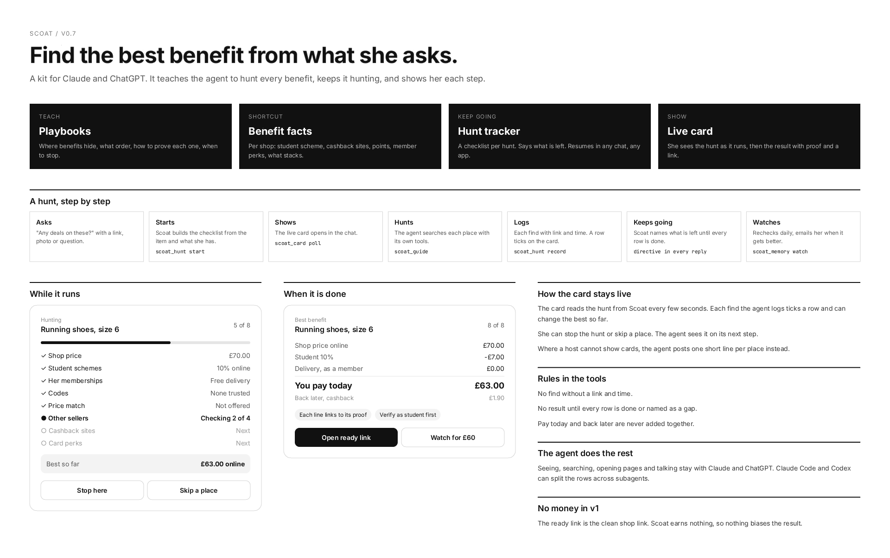
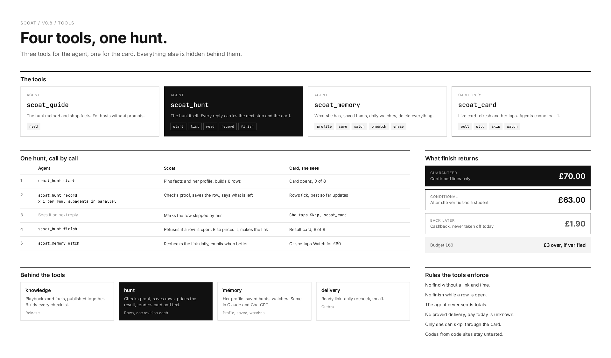
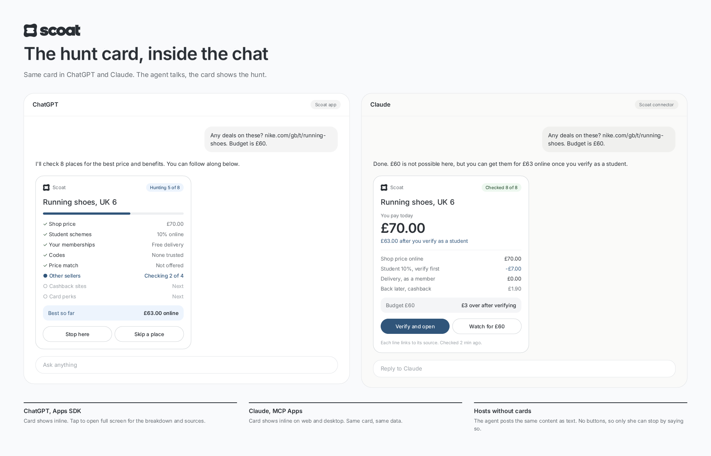
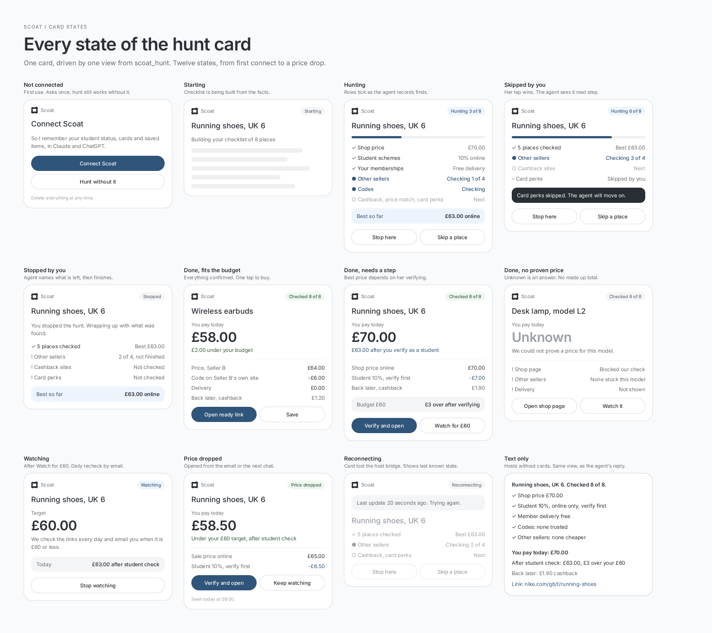
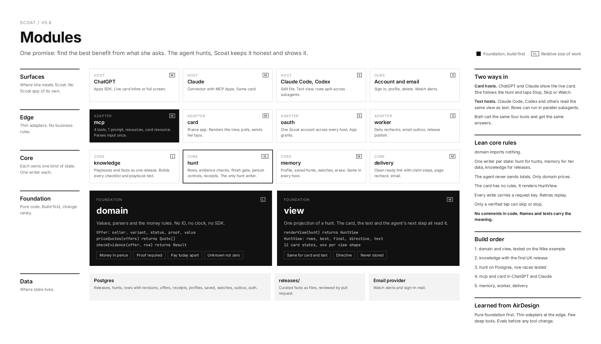
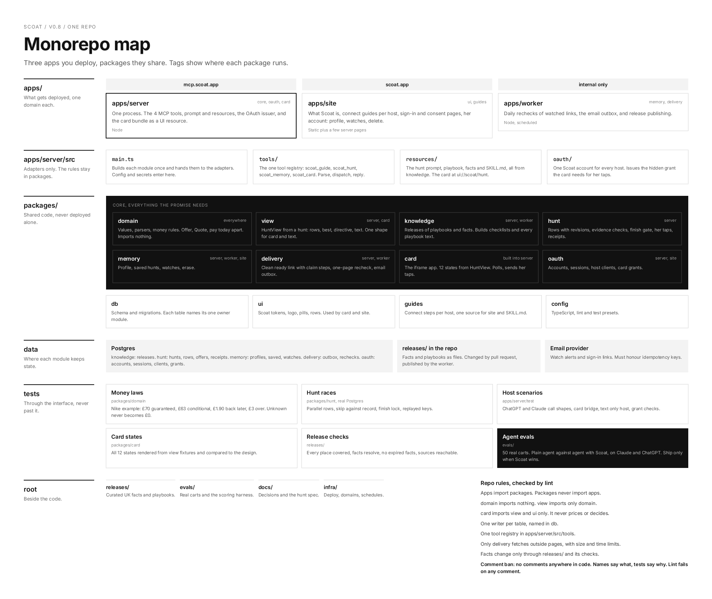
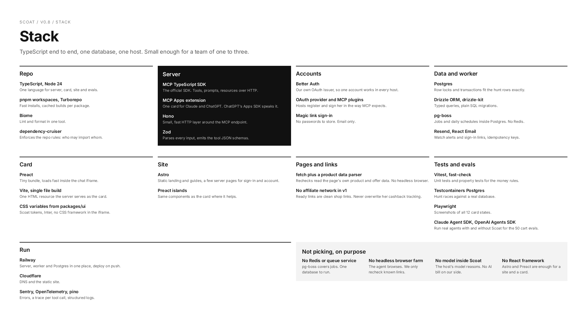

# Scoat

Find the best benefit from what she asks.

Scoat is a kit for Claude and ChatGPT. It teaches the agent to hunt every benefit (price, student discount, member perks, cashback, points, card perks), keeps it hunting until every place is checked, and shows her each step in a live card inside the chat. The agent sees, searches and talks. Scoat brings playbooks, curated shop facts, a hunt tracker, the card, and memory that lasts across chats and hosts.

Status: design and type scaffold. Every function body is `not implemented`.

Licensed under the [MIT License](LICENSE).

## Tools

| Tool | For | Does |
|---|---|---|
| `scoat_guide` | agent | The hunt method and shop facts, for hosts without prompts |
| `scoat_hunt` | agent | start, list, read, record, finish. Every reply carries the next step and the card |
| `scoat_memory` | agent | profile, save, watch, unwatch, erase |
| `scoat_card` | card only | poll, and her Stop, Skip and Watch taps |

## Where things are

| Path | What |
|---|---|
| `RATIONALE.md` | The architecture: usage, shape, synthesis decision, tradeoffs, open questions |
| `src/` | Type scaffold: domain, knowledge, hunt, memory, delivery, mcp, card |
| `docs/brainstorm.md` | How the idea evolved, the reviews, and every decision |
| `docs/implementation-notes.md` | Design intent per function, kept out of the code |
| `arch/` | The spec and the three candidate designs from the architecture arena |
| `design/boards/` | The canvas boards as images |
| `design/canvas/` | The Brilliant canvas source |
| `scripts/check-no-comments.mjs` | Fails the build on any comment in code |

## Boards

| Board | |
|---|---|
|  | Find the best benefit from what she asks |
|  | Four tools, one hunt |
|  | The hunt card inside ChatGPT and Claude |
|  | Every state of the hunt card |
|  | Modules |
|  | Monorepo map |
|  | Stack |

## Checks

```sh
npm install
npm run typecheck
npm run lint:comments
```
