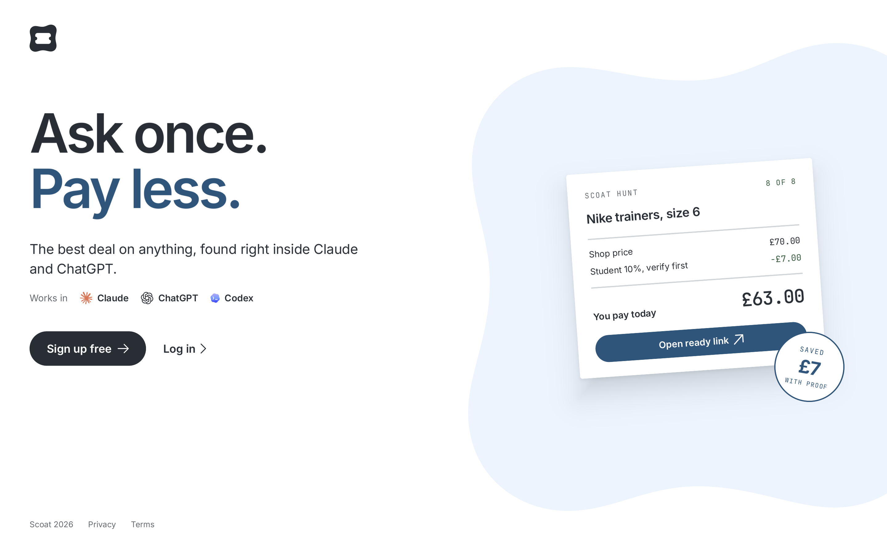
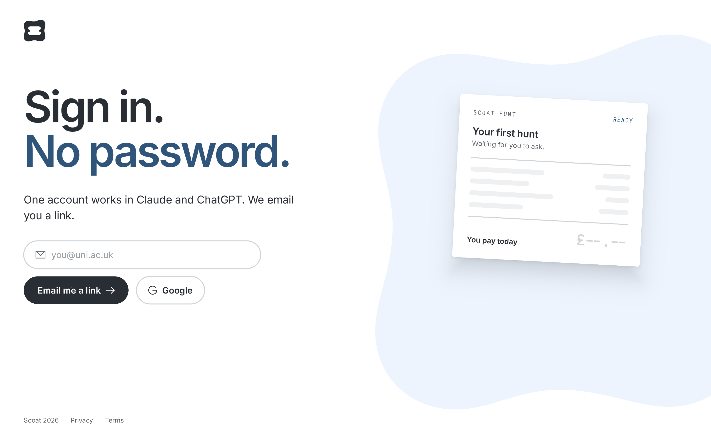
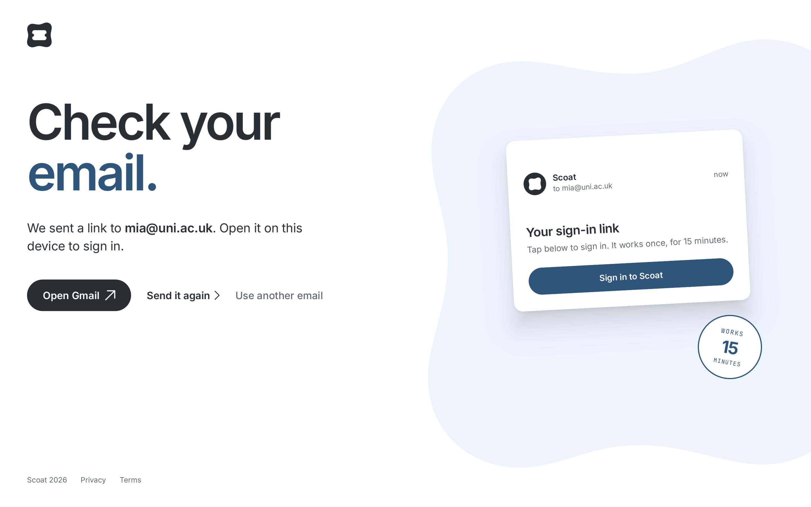
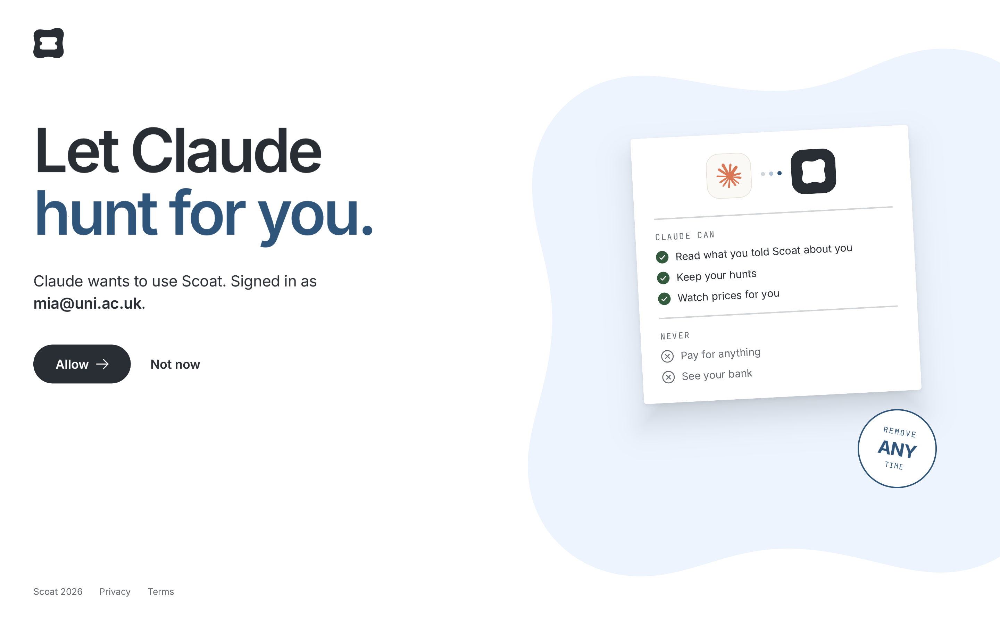
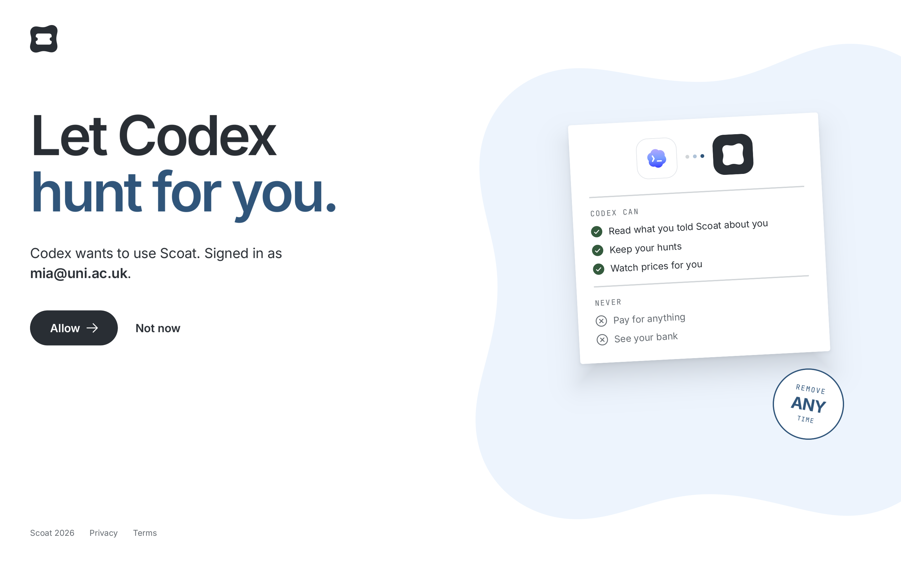
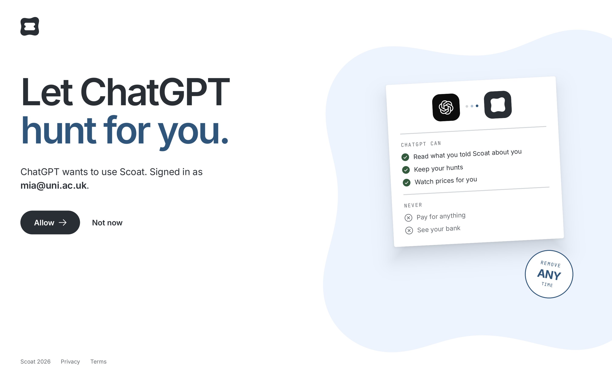
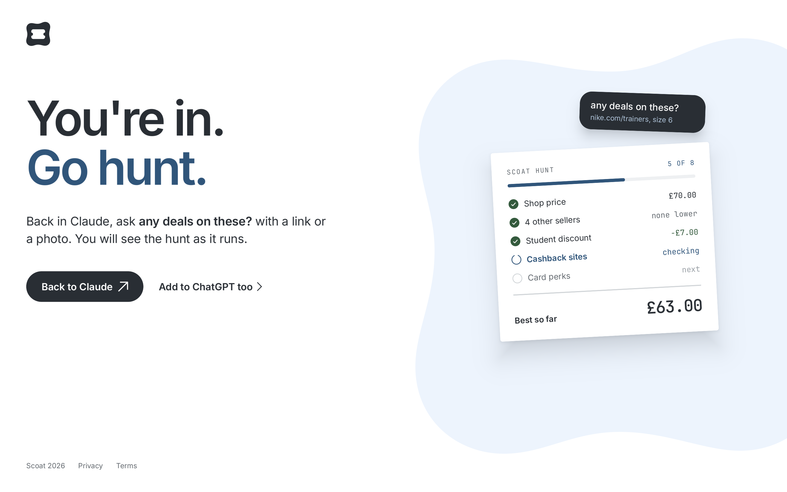

# Landing

Concept art for scoat.app: one landing page and the sign-in flow. Source is `design/canvas/Landing.bl` (Brilliant project "Scoat", canvas Landing).

| Screen | |
|---|---|
|  | Ask once. Pay less. Sign up or log in |
|  | Email link, no password, or Google |
|  | Link sent, works for 15 minutes |
|  | Claude asks to use Scoat |
|  | Codex asks to use Scoat |
|  | ChatGPT asks to use Scoat |
|  | You're in. Go hunt |

Claude, ChatGPT and Codex marks are trademarks of Anthropic and OpenAI, from the LobeHub icon set. Check each brand's rules before public use.
